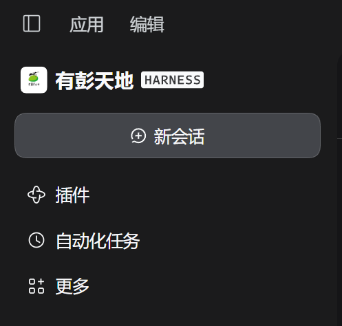
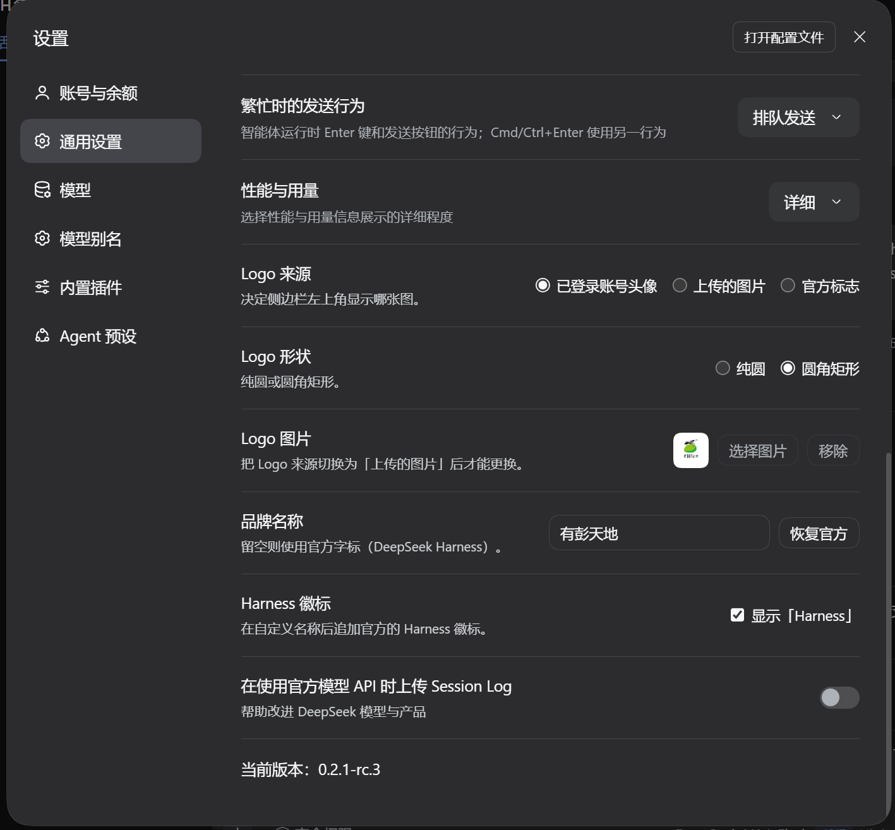

# Brand Studio — sidebar branding for DeepSeek Harness

[](LICENSE)
[](https://github.com/deepseek-ai/deepseek-harness)

An **unofficial community plugin** for [DeepSeek Harness](https://github.com/deepseek-ai/deepseek-harness) (DSH).
It replaces the brand mark and name at the top of the sidebar with your own, and folds
its settings into the existing **Settings → General** page — no extra entry in the
settings navigation.

> 中文说明：[README.md](README.md)

## Features

| Setting | Options | Effect |
| --- | --- | --- |
| Logo source | Signed-in account avatar / Uploaded image / Official mark | Which picture the brand row and the collapsed rail show |
| Logo shape | Circle / Rounded square | A circle also sets `corner-shape: round`, otherwise the theme's superellipse turns it into a squircle |
| Brand name | free text (≤ 24 chars) | Empty keeps the official `DeepSeek Harness` wordmark |
| Harness badge | on / off, custom names only | Appends the official "HARNESS" pill badge after a custom name |

Rules worth knowing:

- The official wordmark is one picture spelling "DeepSeek Harness", so it is never split:
  with the name empty the badge toggle is locked on and the shipped logo is left intact.
- The account-avatar source needs a signed-in account; a signed-out account, an account
  without a picture, or an empty upload slot falls back to the official mark instead of
  leaving a blank cell.
- Only the "Uploaded image" source can be changed or removed here — the account picture
  belongs to the account and the official mark to the build.
- Choosing "Uploaded image" with nothing stored opens the file dialog right away.

## Screenshots

The sidebar brand row (account avatar + custom name + official Harness badge):



The five rows live in **Settings → General**:



## Requirements

- DSH **0.2.1-rc.3** or nearby (the version this was built and verified against).
- Web and desktop (Windows / macOS). The Windows caption layout's 1px shift is handled.

## Install

Install it straight from the Plugins page — no command line needed:

1. Open **Plugins** in the sidebar and click **Add plugin**.
2. Paste the repository address:

   ```
   https://github.com/elliotmasheal/dsh-brand-studio
   ```

3. Enable `dsh-brand-studio` if it did not enable itself, then refresh the page.
4. Open **Settings → General** and scroll down: five brand rows mean it worked.

If the repository is still private, the installing machine needs access to it; once it is
public the address is enough.

To remove it, uninstall the bundle from the plugin list; the brand seats return to the
official occupants immediately.

## Usage

The five rows (orders 40–44, after "Performance & usage"):

| Row | What it does |
| --- | --- |
| Logo source | Three-way choice; the account item is disabled while signed out |
| Logo shape | Circle or rounded square |
| Logo image | 32px preview + choose / remove; disabled unless the source is "Uploaded image" |
| Brand name | Type to apply live; "Use official" clears it |
| Harness badge | Locked on while the official name is in use |

Settings live in the renderer's `localStorage` (`dsh.custom-brand.v1`). Uploaded pictures
are centre-cropped to 192×192 WebP first, so they do not exhaust the quota. Everything is
per-device, with no sync.

## How it works

- Slots only, no DOM surgery: `sidebar.brand.mark` / `sidebar.brand.name` are occupied
  only while there is something to show (priority `-1` over the official occupant), and
  released otherwise so the shipped fish mark and wordmark return untouched.
- The settings are five `settings.general.item` rows rather than a page of their own.
- The avatar comes from the sanctioned Remote namespace: `ctx.remote.account.watch()`
  for the sign-in state and `getProfile({ version, locale, timezoneOffsetSeconds })` for
  `avatarUrl`, shown only after the browser decoded it.
- The Harness badge is not typed text: it is an inline SVG rebuilt from the official
  wordmark's own geometry, coloured with theme tokens.

## Development

```sh
node --check client.js
node --check index.js
```

Edits to `client.js` hot-reload; no restart needed. Conventions are in
[CONTRIBUTING.md](CONTRIBUTING.md).

## Known limitations

- The badge geometry was extracted from the current DSH wordmark; a rebrand upstream means
  updating `HARNESS_GLYPHS`.
- Settings are local to this machine's `localStorage`.
- Mutually exclusive with any other plugin occupying `sidebar.brand.*`.
- The rows cannot live on the Account page: the settings system has no in-page seat and a
  reused section id replaces the whole page.

## License

[MIT](LICENSE). Trademarks and third-party artwork are covered in [NOTICE](NOTICE):
DeepSeek and DeepSeek Harness are trademarks of their owner, this project is not
affiliated with DeepSeek, and the official badge glyph geometry is not part of the MIT
grant.
